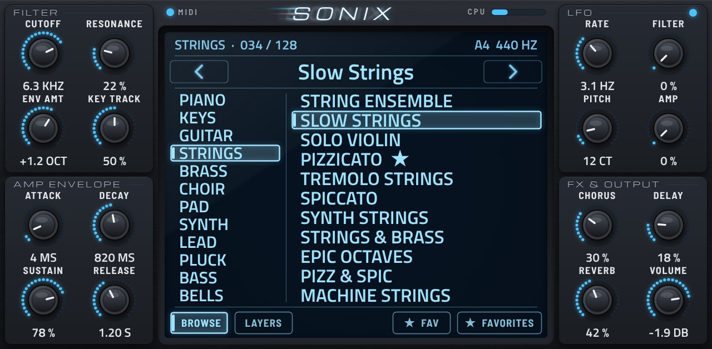
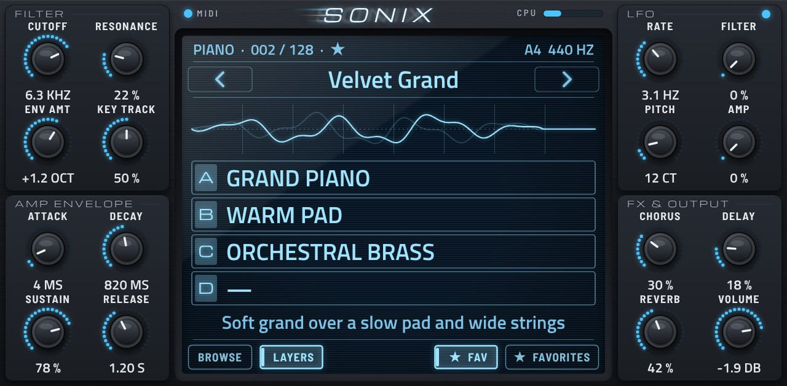
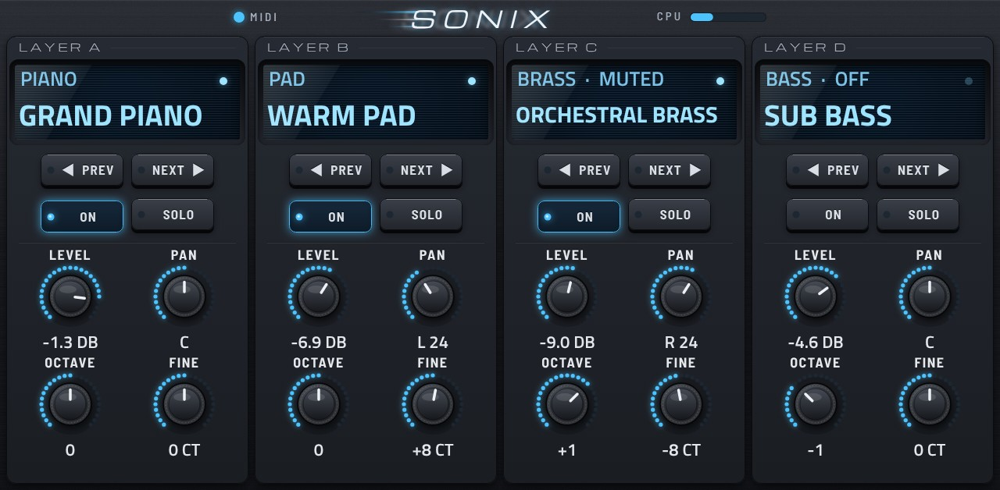
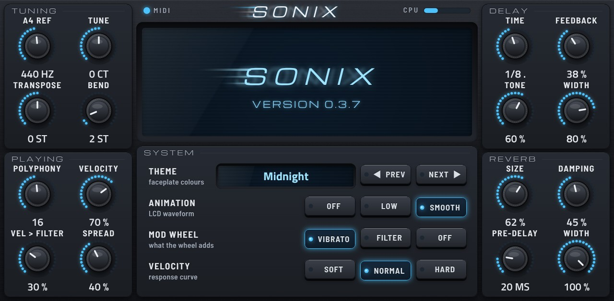
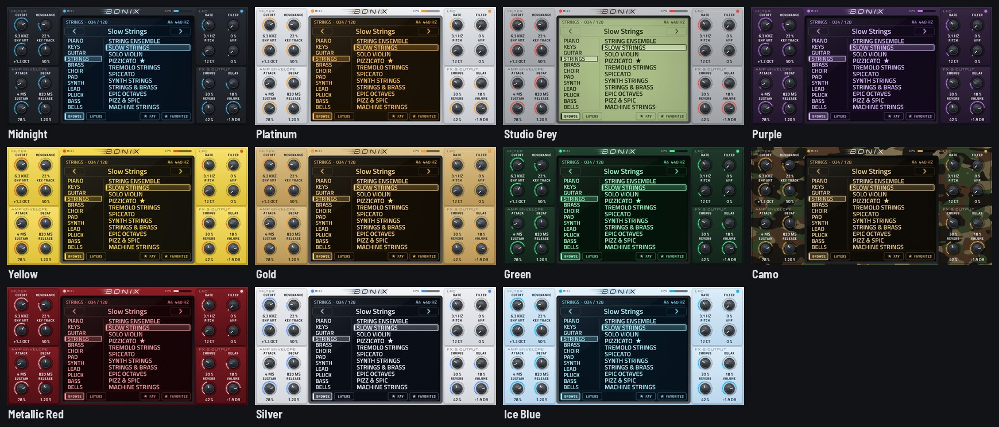

# Sonix

A ROMpler instrument plugin for Akai MPC standalone devices (built and tested on an MPC Live II): 128 presets, 45
instruments, four layers per preset, built-in effects and a touch faceplate in eleven colorways. It runs natively on
the MPC as an ARM VST2 plugin, built on [sd88me/mpc-vst-plugins](https://github.com/sd88me/mpc-vst-plugins).



## Features

- **128 presets in 12 banks:** piano, keys, guitar, strings, brass, choir, pad, synth, lead, pluck, bass, bells.
  They also appear in MPC's own PRESET list.
- **45 instruments** from open recordings (CC0 / CC BY) and original synth renders, about 115 MB in total.
  Every preset plays the moment you pick it.
- **Four layers per preset**, each with its own sound, level, pan, octave, fine tune, on and solo.
- **Sound shaping:** a 12 dB filter with envelope, key and velocity tracking; amp envelope; an LFO for filter,
  vibrato and tremolo; chorus, a tempo-synced delay and reverb.
- **Favourites:** star any preset and find them all in one list.
- **Eleven colorways:** Midnight, Platinum, Studio Grey, Purple, Yellow, Gold, Green, Camo, Metallic Red, Silver,
  Ice Blue.
- **Made for the MPC:** every page has 16 Q-Links in four columns of four, the data wheel browses presets, and
  your edits, layers, favourites and theme are saved with the project.

## The pages

### MAIN

The centre screen has two views, picked with **BROWSE** and **LAYERS** at its foot.

- **BROWSE:** banks on the left, that bank's presets on the right. Tap a bank, then tap a preset to load it.
- **LAYERS:** a live waveform, the four layers (tap one to turn it on or off) and the preset's description.



| Control | What it does |
| --- | --- |
| ◀ ▶ | previous / next preset in the bank |
| Preset name, data wheel, Q-Link 16 | step through presets one at a time; after touching a bank the wheel steps banks |
| ★ FAV | mark or unmark the current preset as a favourite |
| ★ FAVORITES | list every favourite (11 per page); tap again to go back to the bank |
| FILTER, AMP ENVELOPE, LFO, FX & OUTPUT | the 16 knobs; one Q-Link column each |

The top line shows the bank, the preset number, ★ for a favourite and EDITED once you change a knob. The MIDI light,
LFO light and CPU bar are in the header.

### LAYERS

One strip per layer: its sound on a small screen, ◀ PREV / NEXT ▶ to change the sound, ON, SOLO, and LEVEL, PAN,
OCTAVE, FINE (one Q-Link column per layer). The light on each screen shows when that layer is sounding.



### SETTINGS

TUNING (A4 reference, tune, transpose, bend range), PLAYING (polyphony, velocity, velocity to filter, stereo spread),
DELAY (time, feedback, tone, width) and REVERB (size, damping, pre-delay, width). In the centre: the colorway
(◀ PREV / NEXT ▶), the waveform animation (OFF / LOW / SMOOTH), the mod wheel (vibrato, filter or off) and the
velocity curve (soft / normal / hard).



### Colorways



## Install

Build on a Windows PC with WSL (Ubuntu) and Docker Desktop: start Docker Desktop, then run in Ubuntu

```sh
cd ~ && { [ -d Sonix ] || git clone https://github.com/3dthc/Sonix.git; } && cd Sonix && git pull && bash install.sh
```

The first build downloads and builds the instruments (several minutes). It ends with
`Sonix-<version>-mpc-armv7.zip` in your Windows Downloads. Install it on the MPC like any other plugin, then restart
the MPC. TESTING.md has a checklist for trying a new build.

## Building from source

The sections below are for working on Sonix itself.

### Repository layout

| Path | What |
| --- | --- |
| `src/engine.c` | the plugin engine (`mpc_engine()`, see mpc-vst-plugins `wrapper/engine.h`) |
| `src/instruments.h` | the instrument table (generated by `tools/pack_sonix.py`) |
| `src/params.h`, `src/presets.h`, `vst/params.json` | the parameters and the factory presets (generated by `tools/sonix_params.py` from it and `tools/presets.py`) |
| `vst/` | `vst.json`, `params.json`, `build.sh` for mpc-vst-plugins' `build_port.sh` |
| `vst/layout.conf`, `vst/art/`, `vst/skin.css` | the faceplate: layout and artwork, all drawn by `tools/make_skin.py` |
| `vst/fonts/` | Michroma, Share Tech Mono, Barlow Semi Condensed (SIL Open Font License) for the baked artwork |
| `tools/` | the library pipeline: source fetch, prep, renders, checks, packing, audition clips |
| `library/<instrument>/keymap.json` | every instrument's zones, loops, tuning and the original file each sample came from |
| `library/LICENSES.md`, `library/files.csv` | sources and licenses, per instrument and per file |
| `engine/` | the packed instruments the plugin loads (built, not committed; shipped in the release zip) |

### Building the library

```sh
tools/fetch_sources.sh           # clones the upstream sample sets into raw/ (only the folders Sonix uses)
python3 tools/build_demo.py      # batch 1: pianos, strings, nylon guitar and the first renders
python3 tools/build_batch2.py    # batch 2: keys, mallets, bells, harp, kalimba, brass and more renders
python3 tools/build_batch3.py    # batch 3: more strings, guitars, basses, pads, leads, flute, sax
python3 tools/check.py           # pitch, loop-seam and level checks
python3 -I tools/pack_sonix.py   # engine/*.snx and src/instruments.h
python3 tools/sonix_params.py    # vst/params.json, src/params.h, src/presets.h (the presets are tools/presets.py)
```

Needs Python 3 with numpy, scipy and soundfile (or just git and Docker: `tools/build_library.sh` runs it all in a
container, and `install.sh` calls it when `engine/` is empty). Every recorded sample set is mapped by measured pitch, since several
upstream libraries name their notes an octave or two away from where they sound.

### The faceplate

`python3 tools/make_skin.py` redraws every picture for the three pages and eleven colorways in headless Chromium
(Playwright) and writes `vst/layout.conf` from the same coordinates; both are committed, so the plugin build only
reads them (`--mockup <dir>` draws full-page previews with MPC's live text). The engine changes the page's pictures
(LEDs, CPU bar, lit rows) only on events and the LCD waveform at most every 100 ms while notes sound, since
every repaint costs MPC's screen thread; the live text doesn't change while you play, so MPC's PRESET list stays
open.

## Sound sources

All recorded material is CC0 or CC BY; the rest is synthesized by `tools/synth.py`. See `library/LICENSES.md`.

- [VSCO 2 Community Edition](https://github.com/sgossner/VSCO-2-CE) (CC0)
- [Versilian Community Sample Library](https://github.com/sgossner/VCSL) (CC0)
- [Meta Open Sound](https://github.com/facebookincubator/Meta-open-sound) (CC0)
- [Salamander Grand Piano](https://github.com/sfzinstruments/SalamanderGrandPiano) by Alexander Holm (CC BY 3.0)

The sample codec and loader are adapted from [Fretty](https://github.com/3dthc/fretty-mpc) (MIT).
